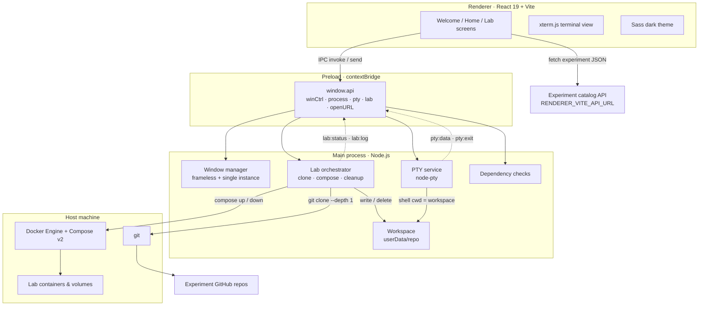
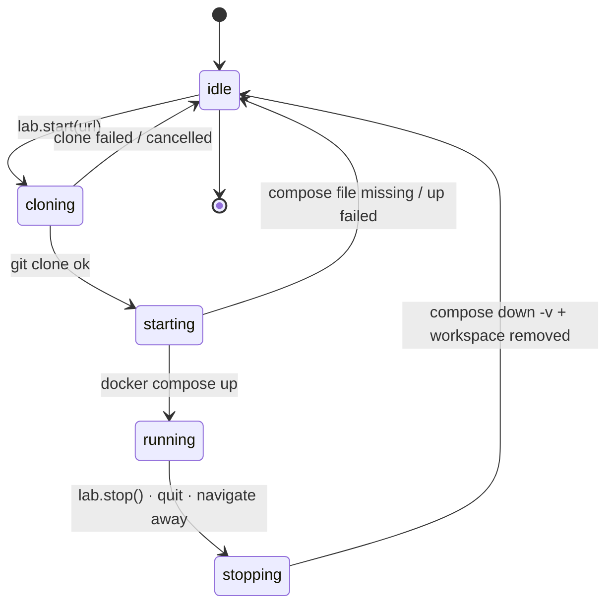
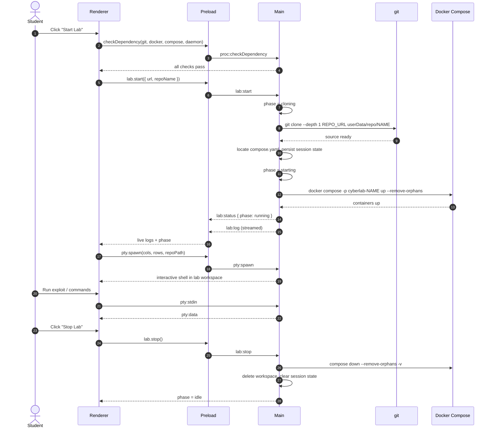
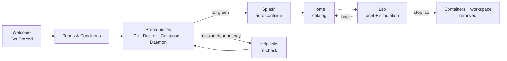

<div align="center">


# CRCE Cyber Lab

**A desktop cyber-range for hands-on security experiments — pick an experiment, the app clones its repo, spins up the lab in Docker, and drops you into a real terminal.**

[](https://www.electronjs.org/)
[](https://react.dev/)
[](https://www.typescriptlang.org/)
[](https://electron-vite.org/)
[](https://docs.docker.com/compose/)
[](#-requirements)

</div>

---

## 📖 What is this?

**CRCE Cyber Lab** is a cross-platform Electron desktop application that turns a list of
cybersecurity experiments into one-click, isolated labs.

Instead of asking a student to install a VM, clone a repository, read a `README`, and
manually run `docker compose up`, the app does the boring parts:

1. Shows a searchable catalog of experiments fetched from a remote API.
2. Opens the experiment brief (aim, theory, objective, procedure, references) as rendered Markdown.
3. Clones the experiment's GitHub repository into a per-user workspace.
4. Runs its `docker compose` stack and streams the build/startup logs live.
5. Gives you an **embedded terminal** that is already `cd`'d into the lab workspace, with
   `COMPOSE_FILE` / `COMPOSE_PROJECT_NAME` exported so `docker compose` commands "just work".
6. Tears everything down — containers, volumes and the cloned repo — when you stop the lab
   or quit the app (and cleans up leftovers after a crash on the next boot).

> The desktop shell is frameless with a custom title bar, a dark theme, and a first-run
> onboarding flow that verifies Git, Docker, Docker Compose and the Docker daemon before
> letting you in.

---

## ✨ Features

| Area | What it does |
| --- | --- |
| 🧭 **Onboarding** | Get Started → Terms & Conditions → Prerequisite checks, with animated direction-aware transitions and a checkpoint stepper. |
| 🔍 **Catalog** | Remote experiment feed with text search, category tabs and difficulty filter, skeleton loaders and empty states. |
| 📚 **Experiment brief** | Markdown-rendered Aim / Theory / Objective / Procedure / References tabs with pull-to-refresh and toast error handling. |
| 🧪 **Simulation tab** | One-click lab start, phase indicator (`cloning → starting → running`), live colour-coded compose logs (capped at 400 lines). |
| 💻 **Real terminal** | `xterm.js` + `node-pty` shell running **on the host**, auto-resized, auto-fitted, and scoped to the lab workspace. |
| 🛡 **Dependency guard** | Verifies `git`, `docker`, `docker compose` and a reachable daemon (`docker ps`) before any lab starts. |
| 🧹 **Guaranteed cleanup** | `docker compose down -v --remove-orphans`, workspace deletion, session-state file, plus boot-time recovery of a previous crashed session. |
| 🪟 **Native feel** | Frameless transparent window, custom minimise/maximise/close, single-instance lock, external links opened in the default browser. |

---

## 🏗 Architecture

Electron is split into three worlds: the **React renderer** (no Node access), the
**preload bridge** (the only allow-listed API surface), and the **main process** (all
privileged work — filesystem, `git`, Docker, PTYs).



### Lab lifecycle

A lab is a small state machine. Every transition is pushed to the renderer, so the UI
always reflects what the main process is really doing.



### End-to-end sequence



### First-run flow



---

## 🧰 Tech stack

| Layer | Technology |
| --- | --- |
| Shell | Electron 39 (frameless, `contextIsolation`, `sandbox`) |
| Build | electron-vite 5, Vite 7, TypeScript 5.9 |
| UI | React 19, React Router 8 (`createHashRouter`), Sass, lucide-react, Motion |
| Terminal | `@xterm/xterm` 6, `@xterm/addon-fit`, `node-pty` |
| Content | `react-markdown` + `remark-gfm` |
| UX | `react-toastify`, `react-simple-pull-to-refresh` |
| Labs | Git + Docker Engine + Docker Compose v2 |
| Packaging | electron-builder (NSIS, DMG, AppImage, snap, deb) |

---

## ✅ Requirements

| Requirement | Notes |
| --- | --- |
| **Node.js ≥ 20** | Developed on Node 22. Needed only for development/building. |
| **npm** | `package-lock.json` is committed — use `npm ci` for reproducible installs. |
| **Git** | Used to clone experiment repositories. |
| **Docker Engine + Compose v2** | `docker compose version` must work; the daemon must be running. |
| **Build tools** | `node-pty` is a native module. Linux: `build-essential python3`; macOS: Xcode CLT; Windows: VS Build Tools + Python. |

> The app checks all four at runtime and refuses to start a lab if anything is missing,
> showing install links instead of a cryptic failure.

---

## 🚀 Getting started

```bash
# 1. Clone
git clone https://github.com/ybhavesh-0915/cyber-lab.git
cd cyber-lab

# 2. Install dependencies (rebuilds node-pty for Electron)
npm install

# 3. Configure the catalog API
cp .env.example .env
# edit .env → RENDERER_VITE_API_URL=https://your-catalog-api/

# 4. Run
npm run dev
```

### Environment variables

| Variable | Required | Description |
| --- | --- | --- |
| `RENDERER_VITE_API_URL` | yes | Endpoint returning the experiment catalog (JSON array, or `{ "data": [...] }`). Requests send `ngrok-skip-browser-warning: true` so tunneled dev APIs work. |

`.env` is git-ignored; only `.env.example` is tracked.

### Catalog API contract

Each experiment object looks like this:

```jsonc
{
  "id": "exp-001",
  "title": "SQL Injection 101",
  "description": "Exploit an unsanitised login form.",
  "category": "Web Security",          // Web Security | System | Network | Cryptography
                                       // Authentication Security | Malware Analysis
  "difficulty": "Beginner",            // Beginner | Intermediate | Advanced
  "github_url": "https://github.com/org/lab-sqli",
  "github_repo_name": "lab-sqli",
  "github_issue_url": "https://github.com/org/lab-sqli/issues",
  "aim": "https://.../aim.md",
  "theory": "https://.../theory.md",
  "objective": "https://.../objective.md",
  "procedure": "https://.../procedure.md",
  "references": "https://.../references.md"
}
```

The five content fields are URLs; the Lab screen `fetch`es them and renders the returned
Markdown.

### Lab repository contract

The cloned repo must contain a Compose file. The app searches, in order:

```
compose.yaml · compose.yml · docker-compose.yaml · docker-compose.yml
```

…in the repo root, then `docker/`, then `compose/`. Containers are namespaced with
`-p cyberlab-<repo>` so different labs never collide.

---

## 📜 Scripts

| Command | Description |
| --- | --- |
| `npm run dev` | Start Electron + Vite with HMR. |
| `npm run typecheck` | Type-check main/preload and renderer projects. |
| `npm run lint` | ESLint over the workspace. |
| `npm run format` | Prettier write. |
| `npm run build` | Type-check, then build main/preload/renderer into `out/`. |
| `npm start` | Preview the production build. |
| `npm run build:unpack` | Unpacked app directory (fast smoke test). |
| `npm run build:win` | Windows NSIS installer. |
| `npm run build:mac` | macOS DMG. |
| `npm run build:linux` | AppImage, snap and deb. |

---

## 🗂 Project structure

```text
cyber-lab/
├── src/
│   ├── main/                        # Electron main process (privileged)
│   │   ├── index.ts                 # App bootstrap, IPC wiring, quit cleanup
│   │   ├── Process/
│   │   │   ├── checkDependency.ts   # git / docker / compose / daemon probes
│   │   │   ├── Lab.ts               # clone → compose up → logs → down
│   │   │   ├── LabEnv.ts            # COMPOSE_* env shared with the shell
│   │   │   └── Terminal.ts          # node-pty session lifecycle
│   │   └── Window/
│   │       ├── Property.ts          # BrowserWindow options (frameless)
│   │       ├── Controls.ts          # minimise / maximise / close
│   │       ├── Instance.ts          # single-instance focus
│   │       └── RepoDir.ts           # userData/repo workspace helpers
│   ├── preload/                     # contextBridge allow-list (window.api)
│   ├── renderer/
│   │   └── src/
│   │       ├── Layouts/             # Welcome, Splash, Home, Lab, Header
│   │       ├── Components/          # Terminal, LabSimulation, LabInfo, cards…
│   │       ├── Sass/                # Theme, layout and component styles
│   │       ├── Constant/            # Terms & conditions content
│   │       ├── Assets/              # Logo, SVG illustrations
│   │       └── main.tsx             # Hash router + toast container
│   └── shared/                      # Types shared by main + renderer
│       ├── experiment.ts            # Experiment, categories, difficulties
│       └── lab.ts                   # LabPhase, LabStatus, LabLog, snapshots
├── build/                           # Icons / entitlements for electron-builder
├── electron.vite.config.ts          # @renderer and @shared aliases
└── electron-builder.yml             # Packaging targets
```

---

## 🔌 IPC surface

Everything the renderer can do is declared in `src/preload/index.ts`. Nothing else is
reachable from the page.

| Channel | Direction | Purpose |
| --- | --- | --- |
| `win:minimize` / `win:maximize` / `win:close` | renderer → main | Custom title-bar controls |
| `open-external-url` | invoke | Open a link in the OS browser |
| `proc:checkDependency` | invoke | `git`, `docker`, `compose`, `dockerDaemon` probes |
| `lab:start` / `lab:stop` / `lab:status` | invoke | Drive and inspect the lab lifecycle |
| `lab:log` / `lab:status` | main → renderer | Streamed compose output and phase changes |
| `pty:spawn` / `pty:stdin` / `pty:resize` / `pty:kill` | mixed | Terminal lifecycle |
| `pty:data` / `pty:exit` | main → renderer | Terminal output and exit notification |

---

## 🔐 Security model

- `contextIsolation: true`, `sandbox: true`, `nodeIntegration: false` — the renderer never
  touches Node APIs directly.
- Only the `window.api` surface defined in the preload script is exposed.
- Repository names are sanitised (path traversal, `..`, leading dots, length) before being
  joined to the workspace path.
- Clones are shallow (`--depth 1`) and land in `app.getPath('userData')/repo`.
- Compose projects are namespaced (`cyberlab-*`) and torn down with `down -v`, so volumes
  from one experiment cannot leak into another.
- A session-state file lets the next launch clean up containers and workspaces left behind
  by a crash or forced quit.
- `GIT_TERMINAL_PROMPT=0` prevents clone commands from blocking on credential prompts.

> ⚠️ **Labs are intentionally vulnerable.** Run experiments only on a machine you own, and
> never expose lab containers to an untrusted network.

---

## 🩺 Troubleshooting

| Symptom | Fix |
| --- | --- |
| Empty catalog / "Device is Offline" | Check `RENDERER_VITE_API_URL`, that the API is reachable, and that it returns an array (or `{ data: [] }`). |
| "Git is not installed" | Install Git and make sure it is on `PATH`. |
| "Docker daemon is not running" | Start Docker Desktop / `sudo systemctl start docker`; verify with `docker ps`. |
| "Docker compose is not installed" | Install the Compose v2 plugin — `docker compose version` must succeed. |
| "No docker compose file found" | The experiment repo needs `compose.yaml` / `docker-compose.yml` in root, `docker/` or `compose/`. |
| Terminal is blank / `[terminal unavailable]` | `node-pty` failed to build. Run `npm rebuild node-pty` (Linux needs `build-essential` + `python3`). |
| Lab stuck in "cloning" | Network/private repo. Private repos are unsupported because clones are non-interactive. |
| Port already in use | Another lab or service holds the port; stop it, then retry. |
| Leftover containers after a crash | Just relaunch — `recoverLabOnBoot` runs `compose down -v` and clears the workspace. |

---

## 🗺 Roadmap

- [ ] Per-experiment progress tracking and scoring
- [ ] Local/offline catalog cache
- [ ] Support for private repos via the system Git credential helper
- [ ] Lab snapshots & reset without re-cloning
- [ ] Automated UI smoke tests (Playwright for Electron)

---

## 🤝 Contributing

1. Fork the repo and create a branch: `git checkout -b feat/my-change`.
2. Keep changes typed and scoped — `npm run typecheck && npm run lint` must pass.
3. Use conventional commit messages (`feat:`, `fix:`, `docs:` …).
4. Open a PR describing the change and how you tested it.

Bugs and ideas → [Issues](https://github.com/ybhavesh-0915/cyber-lab/issues).

---

## 📄 License

No license file is present yet. Until one is added, treat this repository as
**all rights reserved** and contact the maintainer before redistribution.

<div align="center">

Built for hands-on cybersecurity education at **CRCE** · powered by Electron, Docker and a lot of `docker compose down -v`.

</div>
